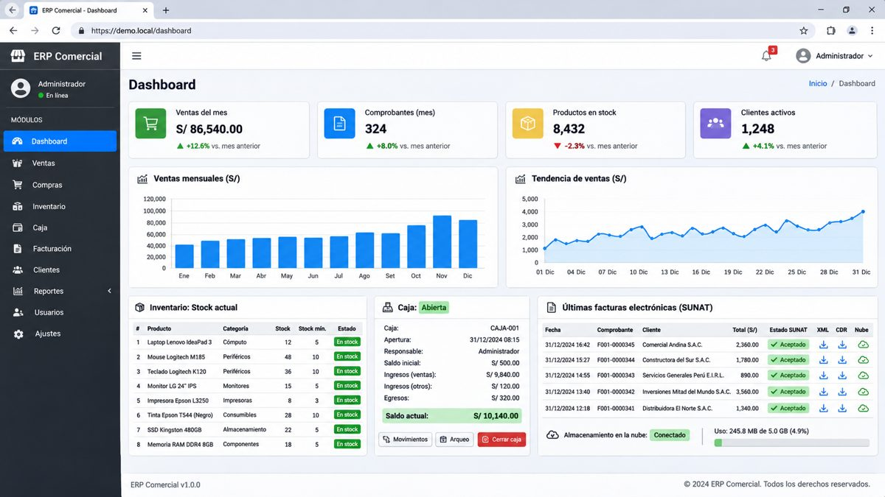
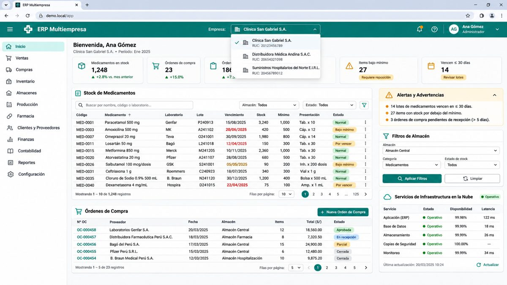
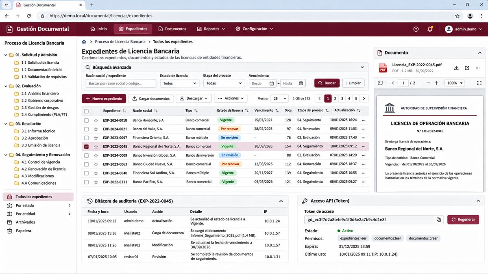
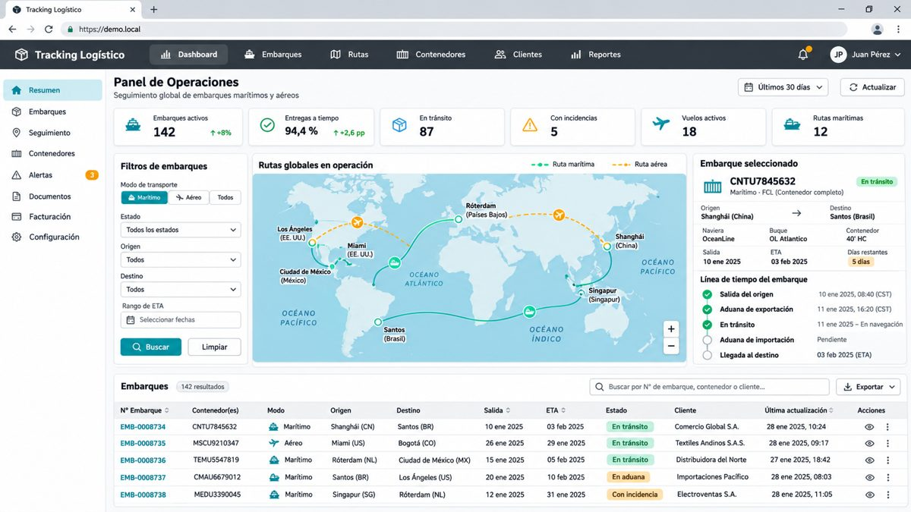
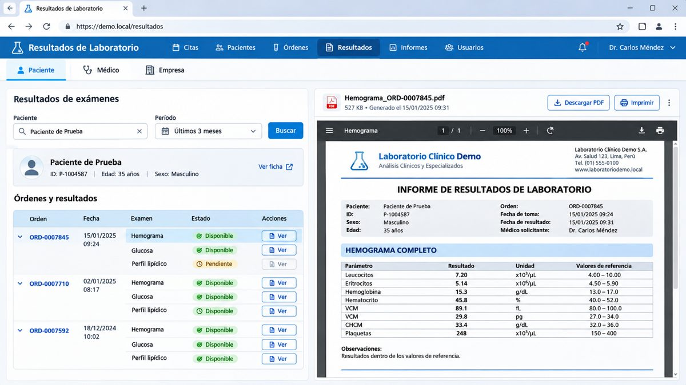
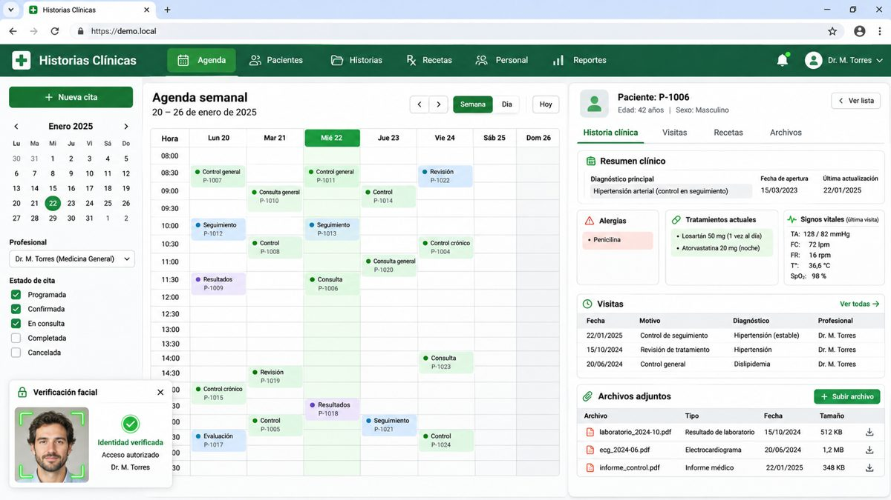
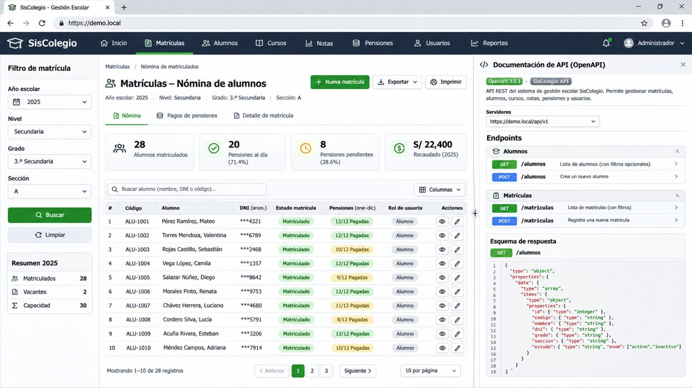
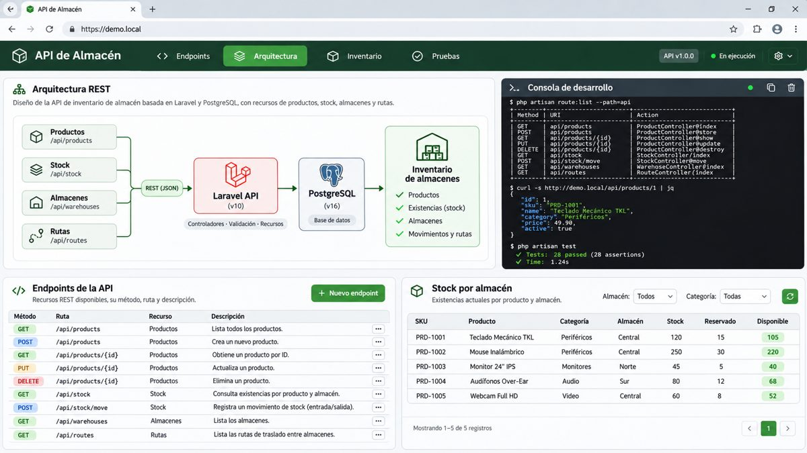
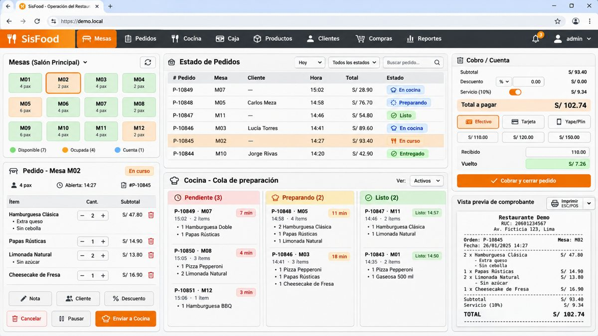
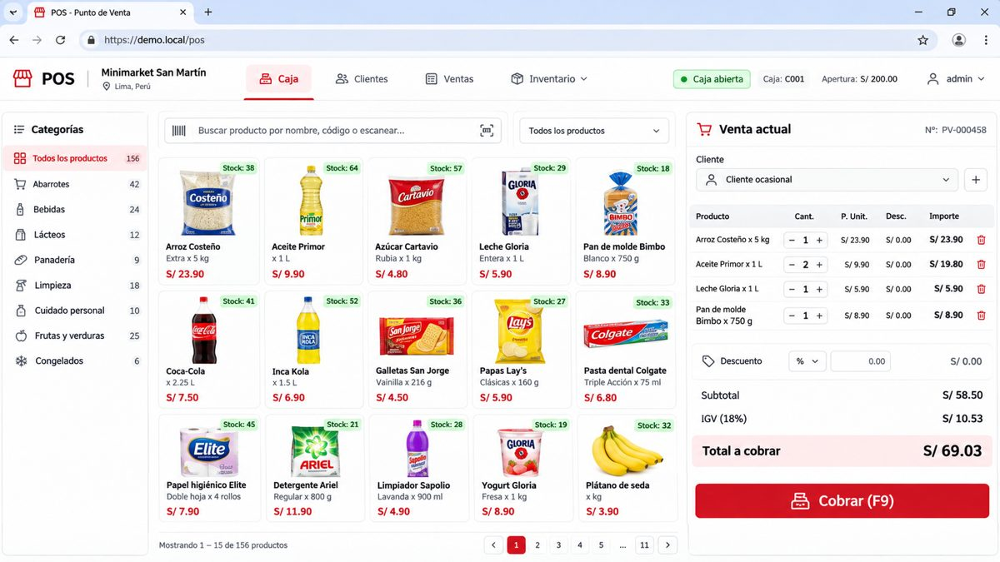

<div align="center">


<a href="https://jspadev.com/nosotros">
  
</a>

<p>
  <a href="https://jspadev.com/nosotros"></a>
  <a href="https://www.linkedin.com/in/jonnypa/"></a>
  <a href="mailto:jonny47169@gmail.com"></a>
  <a href="./cv/Jonny_Ponce_CV_Reclutador_ES.pdf"></a>
  <a href="./cv/Jonny_Ponce_CV_Recruiter_EN.pdf"></a>
</p>


</div>

---

## 👨‍💻 Sobre mí

```yaml
nombre:      Jonny Sebastian Ponce Avilez
rol:         Desarrollador Backend / Full Stack
formación:   Ingeniero de Sistemas titulado (UCV) · Colegiado CIP N° 398379
experiencia: Desde 2018 · +15 sistemas empresariales a medida
enfoque:     [backend, APIs REST, integraciones, facturación electrónica SUNAT]
sectores:    [ERP, salud, logística, banca, retail, educación, construcción]
modalidad:   [presencial, híbrido, remoto]
idiomas:     [Español nativo, Inglés intermedio B1]
```

- 🧩 Construyo **ERP con facturación electrónica SUNAT** (XML/CDR en S3, colas, Jobs y Scheduler con Redis/Horizon).
- 🔐 Diseño **APIs REST** con autenticación por tokens (Sanctum), documentación **OpenAPI** y pruebas con **PHPUnit / Pest / JUnit**.
- ⚡ Optimizo **consultas SQL** para grandes volúmenes y cuido la integridad con transacciones y migraciones.
- 🚀 Despliego en **VPS Linux, Nginx, Docker y AWS** (EC2, RDS, S3).
- 🤝 Trabajo con **Git/GitLab** (Merge Requests, code review) en sprints.

<sub>🇬🇧 <i>Backend / Full Stack developer and licensed Systems Engineer (Peru) building business software since 2018 — Laravel, Spring Boot, .NET and Python. Open to remote roles.</i></sub>

---

## 🛠️ Stack tecnológico

<table>
  <tr>
    <td><b>Backend</b></td>
    <td></td>
  </tr>
  <tr>
    <td><b>Frontend</b></td>
    <td></td>
  </tr>
  <tr>
    <td><b>Bases de datos</b></td>
    <td>
      
      
      
      
    </td>
  </tr>
  <tr>
    <td><b>Móvil</b></td>
    <td></td>
  </tr>
  <tr>
    <td><b>Cloud y DevOps</b></td>
    <td></td>
  </tr>
  <tr>
    <td><b>Herramientas</b></td>
    <td></td>
  </tr>
</table>

---

## 💼 Experiencia

| Periodo | Rol | Empresa | Highlights |
|:--|:--|:--|:--|
| **2019 – 2026** | Desarrollador Full Stack | Datos Dezain Estudio E.I.R.L. | +15 sistemas: ERP con SUNAT, salud, logística, banca, educación · Laravel, Spring Boot, .NET, Django, Vue, React |
| **2018** | Desarrollador de Sistema POS | Vendo Fast | Base de datos, módulos de ventas, inventario, caja y comprobantes · PHP, MySQL |

---

## 🚀 Proyectos destacados

<table>
  <tr>
    <td width="50%" valign="top">
      
      <h4>📊 ERP de Gestión Comercial y Facturación SUNAT</h4>
      Ventas, inventario, caja y facturación electrónica con XML/CDR en S3 procesada con colas y Scheduler.<br/>
      <code>Laravel</code> <code>Vue.js</code> <code>PostgreSQL</code> <code>Redis/Horizon</code> <code>S3</code>
    </td>
    <td width="50%" valign="top">
      
      <h4>💊 ERP Multiempresa de Insumos y Medicamentos</h4>
      Compras, stock y ventas de varias empresas en una sola plataforma, con lotes y vencimientos.<br/>
      <code>Laravel</code> <code>Eloquent</code> <code>PostgreSQL</code> <code>AWS RDS</code> <code>EC2</code>
    </td>
  </tr>
  <tr>
    <td width="50%" valign="top">
      
      <h4>🏦 Sistema Documental Bancario</h4>
      Registro y renovación de licencias, API REST con tokens y SQL optimizado para grandes volúmenes.<br/>
      <code>Laravel</code> <code>Sanctum</code> <code>SQL Server</code> <code>Nginx</code>
    </td>
    <td width="50%" valign="top">
      
      <h4>🚢 Plataforma de Tracking Logístico</h4>
      Seguimiento en tiempo real de embarques marítimos y aéreos con estados, fechas y documentos.<br/>
      <code>Laravel</code> <code>Vue.js</code> <code>APIs REST</code> <code>SQL Server</code>
    </td>
  </tr>
  <tr>
    <td width="50%" valign="top">
      
      <h4>🧪 Portal de Resultados de Laboratorio Clínico</h4>
      Resultados en línea para pacientes, médicos y empresas con acceso por roles e informes PDF.<br/>
      <code>Laravel</code> <code>React</code> <code>SQL Server</code> <code>S3</code>
    </td>
    <td width="50%" valign="top">
      
      <h4>🩺 Historias Clínicas y Citas Médicas</h4>
      Pacientes, historias clínicas y agenda de citas con autenticación facial.<br/>
      <code>Laravel</code> <code>Vue.js</code> <code>MariaDB</code> <code>APIs REST</code>
    </td>
  </tr>
  <tr>
    <td width="50%" valign="top">
      
      <h4>🎓 SisColegio – Gestión Escolar</h4>
      Matrículas, pensiones y permisos con facturación SUNAT; API documentada con OpenAPI y testeada.<br/>
      <code>Laravel</code> <code>OpenAPI</code> <code>PostgreSQL</code> <code>PHPUnit</code>
    </td>
    <td width="50%" valign="top">
      
      <h4>📦 API SICMO y API de Gestión de Almacén</h4>
      Backends de inventario por almacén con roles, permisos, reportes y pruebas automatizadas.<br/>
      <code>Laravel</code> <code>PostgreSQL</code> <code>Pest</code> <code>GitLab</code>
    </td>
  </tr>
  <tr>
    <td width="50%" valign="top">
      
      <h4>🍔 SisFood – Pedidos de Restaurante</h4>
      Mesas, cola de cocina y caja con impresión de tickets en impresoras térmicas ESC/POS.<br/>
      <code>Laravel</code> <code>Blade</code> <code>PostgreSQL</code> <code>ESC/POS</code>
    </td>
    <td width="50%" valign="top">
      
      <h4>🛒 Punto de Venta (POS)</h4>
      Stock, ventas y comprobantes con interfaz rápida para pantallas táctiles.<br/>
      <code>Laravel</code> <code>Vue.js</code> <code>Quasar</code> <code>Docker</code>
    </td>
  </tr>
</table>

<details>
<summary><b>➕ Ver más proyectos</b></summary>
<br/>

| Proyecto | Stack |
|:--|:--|
| Intranet empresarial con facturación | Java · Spring Boot · Spring Security · Angular · Oracle · JUnit |
| POS, ecommerce y biometría dactilar | C# · ASP.NET · Blazor · SQL Server · SourceAFIS |
| Asistencia y planillas con reconocimiento facial | Python · Django · PostgreSQL |
| Gestión de incidencias técnicas | Laravel · Livewire · MariaDB · Tailwind CSS |
| Gestión para construcción | Laravel · Filament · MariaDB · PDF |
| Ecommerce de lentes de contacto | Laravel · Blade · MariaDB · Pasarela de pagos |
| Dezain Ecommerce | Laravel · Nuxt · Alpine.js · Tailwind CSS |
| MyERP Móvil | React Native · Expo · TypeScript |
| App Android de notificaciones de pago | Kotlin · SQLite · API REST |
| Sistema POS – Vendo Fast | PHP · MySQL · JavaScript · Bootstrap |

</details>

---

## 🎓 Formación y certificaciones

- 🏛️ **Ingeniería de Sistemas** – Universidad César Vallejo · Título profesional (2025)
- 🛡️ **Ingeniero Colegiado** – Colegio de Ingenieros del Perú, CD Lima · CIP N° 398379 (2026)
- 💻 **Programa de Desarrollo Web Full Stack** – Academlo (2023)
- 📜 Spring Boot & Spring Framework – **UNI** · API REST con Laravel – **Udemy** · PHP, C# .NET, Kotlin, SQL Server, Oracle SQL, MySQL – **UNI** · AWS CloudOps (prep), Azure y Oracle Cloud – **Udemy**

---

## 📊 Actividad en GitHub

<div align="center">


</div>

---

<div align="center">

### 🤝 ¿Buscas un desarrollador Backend / Full Stack? Hablemos.

<a href="https://www.linkedin.com/in/jonnypa/"></a>
<a href="mailto:jonny47169@gmail.com"></a>
<a href="https://jspadev.com/nosotros"></a>


</div>
